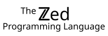

> [!NOTE]
> **Zed is still under construction and is not yet ready for use, but it is coming soon.**
> Releases will be announced at [x.com/zedlang](https://x.com/zedlang). This page describes the language as it will be when finished.

<p align="center">
  
</p>

Zed is a programming language that looks like ordinary code, but has no variables you overwrite and no statement order you have to get right. A Zed program is a set of definitions: each value says what it depends on, and the compiler works out the rest. Because the compiler can see that whole graph of dependencies, it can run your code in parallel, free memory without a garbage collector, recompute only what changed when an input changes and reject many bugs before the program runs.

## Notation

This section lists all the syntax, words and terms the examples on this page use, so you can look up anything you don't recognize. Each one comes back with an example in the tour. If you'd rather start with code, [skip to the first program](#a-first-program) and come back when you need to.

### Conventions on this page

| Form | Meaning |
|---|---|
| `// text` | A comment. |
| `// ✗ rejected` | A commented-out line that the compiler rejects, with the reason. |
| `...` in a **Syntax** line, `x`, `T`, `op`, `pattern`, `fallback`, `#someFailure` | Placeholders for code you would write. In real code, `...` has the one meaning given below. |
| `before:`, `after:` | The inputs and results of the example, in the plain-text blocks and tables below each one. They are not Zed code. |

### Definitions and functions

| Syntax | Meaning |
|---|---|
| `name = value;` | A *binding*: gives a name to a value, once. Definitions can come in any order. |
| `name: T = value;` | A binding with a stated type. |
| `f(x) = expression;` | A function whose body is one expression. |
| `f(x) -> T { ... }` | A function with a stated result type and a block body. The last expression, or `return`, gives the result. |
| `positional x` | A parameter passed by position. Other parameters are passed by name, as in `f(x: 1)`. |
| `y = default` in a parameter list | A parameter that can be left out. |
| `(T) -> U` | The type of a function from `T` to `U`. |
| `x -> expression` | An unnamed function (a lambda). With a type: `(x: rat) -> x + 1r`. |
| `a.f(b)`, `5.double` | A call with the dot: `a.f(b)` is `f(a, b)`, and `5.double` is `double(5)`. |
| `f(x, ...)` | A call that leaves the remaining named parameters open, and gives back a function that takes them. |
| `(+)` | An operator used as a function. |
| `x, y = e;` | Binds each name to a part of a result that has several parts. |
| `field:` in `{ mean:, sd: }` or `Circle(radius:)` | Short for `field: field`. In a pattern it reads the field into a name of the same spelling. |
| `this` | Inside a method: the value the method was called on. |
| `return e;` | Ends a block body with the result `e`. |
| `if c { a } else { b }` | A choice between two values. |
| `match x { pattern -> value, ... }` | Picks the arm whose pattern fits `x`. The arms must cover every case. |
| `for x in a { ... }`, `for x in a, y in b where c { ... }` | Builds a map with one entry per element, or per combination the `where` lets through. |
| `loop { ... }`, `loop t { ... }` | A repeated step, with `t` as its optional step counter. The loop is a value holding the final state and the history. |
| `until c;`, `while c;` | Stop conditions of a loop: `until` is tested after each step, `while` before it. |
| `x' = e` | The value of `x` in the next step of a loop or the next version of a struct. |
| `x[i] = e with x[-1] = start;` | A recurrence: an array defined by an equation, with its boundary value at the index just below the first. |
| `i in 0..` inside `d[i in 0..]` | This entry is defined for every `i` in the range. |
| `x*.method()` | A call in a loop body that also replaces `x` in the next step. |
| `test { input -> output, ... }` | A table of test cases attached to a definition, run at build time. |
| `law name(x: T) = expression;` | A claim that a `bool` expression holds for every `x`. |
| `import a.b;`, `import a.b as c;`, `import a.b.{x, y};` | Imports a module whole, under another name, or by listing names. |
| `local` | Keeps a definition private to its file. |
| `main(input: T) -> (output: U) { ... }` | A program's entry point. Its parameters are input ports and its results are output ports. |
| `@name` | An annotation: a claim or request the compiler acts on or checks. They are listed below. |

### Operators

| Syntax | Meaning |
|---|---|
| `+ - *` | Arithmetic. `*` also scales a vector or matrix by a number. |
| `/` | Division on `f64` and `rat`. It does not apply to `int`. |
| `a div b`, `a mod b` | Integer quotient and remainder. |
| `**` | Power. |
| `== != < <= > >=` | Comparison. `==` compares structure, by value. |
| `\|\|` | Logical or. |
| `a ++ b` | Joins two strings or lists. |
| `x in s` | True if `x` is a member of `s`. |
| `x is T`, `x is not T` | Tests whether a value has a type. |
| `m[k]`, `p.x`, `f(x)` | Lookups, in a map, a struct and a function. |
| `x::word` | Reads a fact about `x`, such as its length or its type's fields. The facts are listed below. |
| `x else d` | Gives `d` in place of a failure. `x else #a -> d` replaces only the atom `#a`. |
| `x?.field` | Reads a field if there is one, and passes a failure along if there isn't. |
| `m >< op` | *Reduces* the innermost level of `m` with the operator `op`. |
| `m >< op else d` | The same, with `d` as the answer for an empty collection. |
| `unordered` after `m >< op` | Gives up the fixed floating-point result in exchange for speed. |
| `m as (pattern) into (pattern)` | A *remap*: names the shape `m` has and the shape you want. |
| `k >< op` inside a pattern | Collapses the level `k` with `op`. |
| `desc k`, `asc k` | Orders by `k`, high to low or low to high. |
| `_` in a pattern | Drops the value at that place. |
| `name <- v`, `name[k] <- v` | Pushes a value out of a port, or into one key of a map. |
| `e with name(args)` | Attaches a *facet* or a port setting to a value or type. They are listed below. |
| `x with { field = value }` | A copy of a struct with some fields changed. |

### Values and literals

| Syntax | Meaning |
|---|---|
| `42`, `1.5`, `3r`, `2n` | An `int`, an `f64`, a `rat`, and a generic number that takes whichever number type is expected. |
| `"text"`, `"${e}"` | A `Utf8String`, with `e` written into it. |
| `#name`, `#name(args)` | An *atom*: a constant that is its own name, with or without a payload. |
| `[a, b, c]` | An array, whose keys are `0`, `1`, `2`. |
| `{ k -> v, ... }` | A map, written out. |
| `{ a, b }` | A set. |
| `{ x: 1, y: 2 }`, `Name(x: 1)` | A struct value, without and with a declared name. |
| `(a, b)` | A tuple. |
| `a..<b`, `a..=b`, `a..` | Ranges: excluding `b`, including `b`, and with no upper end. |

### Types

| Syntax | Meaning |
|---|---|
| `int` | A mathematical integer. It can't overflow. |
| `int[a..=b]`, `int[a..]` | An integer in a range. |
| `f64`, `rat`, `bool`, `u8` | A 64-bit float, an exact rational, true or false, and an integer from 0 to 255. |
| `Utf8String`, `U8String`, `Utf16String`, `Utf32String` | String types, one per encoding. String literals are `Utf8String`. |
| `K -> V` | A map with a value at every key of `K`. A function type too. |
| `K ->? V` | A map that may lack some keys of `K`, so a lookup can give `#notFound`. |
| `a -> b -> v` | A nested map: `a -> (b -> v)`. Each arrow adds one *level* of keys. |
| `[T]` | An array of `T`. |
| `[T; n]`, `[T; r, c]` | A vector of length `n` and a matrix of `r` rows and `c` columns. |
| `A \| B` | A *union*: a value that is either an `A` or a `B`. Its *members* are `A` and `B`. |
| `T` (capitalized and otherwise undefined) | A type variable, when used at least twice in a signature. |
| `struct Name { field: T, field: T = default }` | A record type. Its fields can have defaults. |
| `Name.method = e;`, `Name.method() { ... }` | A method: a function with an implicit first parameter, whose fields are in scope. |
| `type Name = T;`, `type Name(T) = ...;` | A name for a type, with or without type parameters. |
| `interface Name { ... }` | A list of fields and laws. Any value that has them fits it. |
| `grammar { ... }` | A parser and serializer in one definition, on a struct or after `matching`. |
| `T matching grammar { ... }` | The values of `T` that a grammar accepts. |
| `"("`, `x: T`, `a sep b`, `a*`, `digit` in a grammar | Literal text, a field, a list of `a` separated by `b`, zero or more of `a`, and one decimal digit. |
| `Files`, `Lines`, `Stream(T)` | Port types: files by path, lines of text, and a sequence of values over time. |

### Failure atoms

| Atom | Meaning |
|---|---|
| `#notFound` | A lookup found no entry. |
| `#none` | There is nothing here: an empty selection, or the missing side of a left join. |
| `#empty` | A reduction with nothing to reduce. |
| `#collision` | Two entries landed on one key, where a claim that the key is unique was wrong. |
| `#divByZero` | An integer division by zero. |
| `#inexact` | A number conversion that can't keep the exact value. |
| `#invalid` | A value failed a `refine` or a type check at run time. |
| `#syntaxError`, `#parseError` | Text doesn't parse. |
| `#ioError`, `#dbError`, `#timeout` | A port failed, a database failed, or a deadline passed. |

Other atoms on the page, such as `#red` or `#goNs`, are data the examples define. `#left`, `#orderId`, `#fixed`, `#big`, `#clean` and `#userInput` are arguments to the words they follow. `#block`, `#dropOldest` and `#full` say what a full queue does, and `#unbounded` is what a cost reads when no bound could be proved.

### Words from the standard library

| Word | Meaning |
|---|---|
| `m.map(x -> e)` | Replaces each value and keeps the keys. |
| `m.where(x -> c)` | Keeps the entries whose value passes, with their keys. |
| `m.group(x -> key)` | Adds a level of keys above the existing ones. |
| `m.rekey(x -> key)` | Replaces the key. The compiler needs evidence that the new key is unique. |
| `m.sort(desc x -> x)` | Orders by the given key. |
| `m.rank` | Flattens an ordered nested map into one list numbered in that order. |
| `m.chunkBy(x -> key)` | Splits an ordered collection wherever the key changes. |
| `m.flatMap(x -> list)` | Maps each value to a list, with the list's positions as a new level. |
| `a.join(b, on: #field, kind: #left)` | Pairs entries of `a` and `b` on a field. |
| `a.diff(b, on: #field)` | The entries of `a` that have no match in `b`. |
| `.count`, `.sum` | Reduces the innermost level to its number of entries, or to their sum. |
| `.first`, `.last` | The entry at the lowest or highest key, in the collection's order. |
| `.foldl(init, op)`, `.foldr` | A fold from the left or the right, for an operator that can't be regrouped. |
| `m.allOk` | `m` if no entry holds a failure, and otherwise the failures. |
| `.image`, `.union` | The set of a map's values, and the union of two sets. |
| `p.implies(q)` | Logical implication. |
| `x.refine(p)` | `x`, or `#invalid` if the condition `p` fails. |
| `min`, `max`, `sqrt`, `log`, `pi` | The usual math functions and constant. `min` and `max` work as operators for `><`. |
| `fs[path]`, `read(path)` | Reads a file from the port `fs`; `read` is short for that lookup. |
| `.split`, `.lower`, `.len` | Splits a string on a separator, lowers its case, and gives a length. |
| `a.matmul(b)`, `dot`, `cross` | Matrix product, dot product and cross product. |
| `f64(n)`, `int(s)`, `char32("Z")` | Checked conversions between types. |
| `T.parse(s)`, `x.serialize` | A grammar's parser and serializer. |
| `Json.decode(s)` | Decodes JSON into the type expected at the call. |
| `expand`, `derivative`, `compile` | Rewrites a function's source, differentiates it, and turns source back into a function. |

### Facts read with `::`

| Syntax | Meaning |
|---|---|
| `x::len` | The number of entries, or of steps in a loop. |
| `run::frames` | Every step of a loop. |
| `text::codepoints`, `text::u8` | A string viewed by code point or by UTF-8 unit. |
| `T::fields`, `T::shape`, `T::values` | A type's fields, its structure, and the members of a set of atoms. |
| `x::constraints` | What the compiler knows about a value. |
| `f::source` | A function's source, as a value. |
| `f::cost`, `f::depth` | Upper bounds on a function's work and parallel depth. |

### Annotations

| Annotation | Meaning |
|---|---|
| `@associative`, `@commutative` | Claims that an operator can be regrouped or reordered. |
| `@ensure` | Forbids a run-time check in this definition: the condition has to be proved instead. |
| `@injective` | Claims that a function never gives two inputs the same result. |
| `@memoized` | The build fails if this value isn't kept for reuse. |
| `@cost(b)`, `@fused`, `@noalloc`, `@preallocated` | Performance claims the build checks: a work bound, no intermediate collection, no allocation, a bounded footprint. |
| `@exhaustive` | Run the tests on every input of a finite domain. |
| `@proved`, `@strict`, `--strict` | Make the build fail on a law that isn't proved. `--strict` is a compiler flag. |
| `@foreign("lib", "symbol")`, `@export("c", "symbol")` | Calls a C function, and makes a Zed function callable from C. |
| `@stateless` | A promise that a foreign function has no state, so it can be retried. |
| `@hash` | The content hash that pins an import. |

### Facets and port settings, written with `with`

| Word | Meaning |
|---|---|
| `units("m/s")` | A physical unit, checked through arithmetic. |
| `taint(#label)` | A label that follows a value through the program. |
| `reducer(op)` | How values pushed to one key of a map merge. |
| `store(...)`, `postgres(...)`, `kv(...)`, `sql(...)` | Makes a map a stored table: in Postgres, in a key-value store, with a schema read from an SQL file. |
| `timeout(d)`, `retry(n, backoff: b)`, `bound(n, overflow: policy)` | A deadline, repeat attempts, and a queue's size limit with what happens when it is full. |
| `bits(n)`, `endian(#big)`, `length(n)` | Binary layout in a grammar: a field's width, its byte order, its element count. |

### Terms

| Term | Meaning |
|---|---|
| key, value, entry | A map sends each *key* to a *value*, and a key with its value is an *entry*. |
| level | One layer of keys in a nested map. `a -> b -> v` has the two levels `a` and `b`. |
| keypath | The chain of keys that leads to a value, such as `(a, b)`. |
| rank | A position in an order: a key `0`, `1`, `2`, and so on. Values that tie share a rank when `desc` or `asc` adds the level. |
| remap | Changing a map's shape by moving, adding or dropping levels. |
| reduce, reduction, fold | Merging the values of a level into one, with an operator. |
| failure | An atom in a value's type that says the operation didn't give a result. |
| domain | The keys or inputs a map or function is defined on. |
| bounds check | The run-time test that an index is in range. |
| rope | A string or list stored as a tree of pieces, so joining two takes constant time. |
| facet | An extra fact about a value, tracked through every operation at compile time. |
| taint | A label for where a value came from, such as user input. |
| port | A declared channel to the outside world: a file, socket, clock or database. |
| wave | A batch of new input values passing through the program's graph. |
| memoize | Keep a result so that later uses don't compute it again. |
| law | A claim about your code, which the compiler tries to prove and otherwise tests. |
| associative, commutative | `(a op b) op c == a op (b op c)`; and `a op b == b op a`. |
| `Monoid`, `CommRing` | Interfaces from the library for algebraic structures: an associative operator with an identity; and addition with multiplication, where multiplication commutes. |
| partial evaluation | Running the parts of a program whose inputs are known at build time. |
| specialize | Produce a version of a function for known types or values, with the generic steps gone. |
| decidable | Answerable by an algorithm that always finishes. |
| linear arithmetic | Sums of variables times constants, with comparisons. |
| SMT solver | A general automated theorem prover, as used by many verification tools. |
| fixpoint | A value that one more step doesn't change. |
| model checking | Checking a property on every state a system can reach. TLC is a widely used model checker. |
| liveness, fairness | *Liveness*: something good eventually happens. *Fairness*: an assumption that no ready action is put off forever. |
| safe to repeat, idempotence | Doing it twice has the same effect as doing it once. |
| hedged request, circuit breaker, failover | Sending a second copy of a slow request; refusing calls for a while after repeated failures; switching to a replacement server. |
| hash join, merge join | Two standard ways to compute a join without comparing every pair. |
| exact reference counting | Freeing a value when a count of its users reaches zero, with no count left too high by cycles. |
| arena | A block of memory whose contents are all freed together. |
| back end | The part of a compiler that produces code for one target. |
| MLIR, LLVM, Clang | Standard compiler infrastructure, and the C compiler built on LLVM. |
| WebAssembly | A portable binary format that runs in browsers and elsewhere. |
| hardware synthesis | Producing a circuit design in place of machine code. |

## A first program

Here is a complete program. It splits a file on spaces, counts each word, and prints the counts, most common first.

```zed
main(fs: Files) -> (stdout: Lines) {
  text = fs["input.txt"] else "";
  counts = text.split(" ").group(w -> w.lower).count;
  lines = counts as (w -> n) into (desc n -> w -> "${w}: ${n}");
  stdout <- lines.rank;
}
```

`group` collects the words by their lowercase form, and `.count` turns each group into its size. The `as ... into ...` line reshapes that table: `desc n` sorts by count, `w` stays as a level below it so equal counts don't collide, and each value becomes a line of text. `.rank` flattens the nested table into a list numbered in that order, and `<-` writes the lines out.

These tables show the data after each step, for a file whose whole text is `to be or not to be`. Each column but the last is one level of keys, and the last column holds the values. A key is printed once and covers every row inside its box, and rows are listed in key order. This page draws most of its data-shaping examples this way.

```text
after text.split(" ")    after .group(w -> w.lower)    after .count
+---+-----+              +---------+---+-----+         +-----+---+
| i | w   |              | w.lower | i | w   |         | w   | n |
+===+=====+              +=========+===+=====+         +=====+===+
| 0 | to  |              | be      | 1 | be  |         | be  | 2 |
| 1 | be  |              |         | 5 | be  |         | not | 1 |
| 2 | or  |              +---------+---+-----+         | or  | 1 |
| 3 | not |              | not     | 3 | not |         | to  | 2 |
| 4 | to  |              +---------+---+-----+         +-----+---+
| 5 | be  |              | or      | 2 | or  |
+---+-----+              +---------+---+-----+
                         | to      | 0 | to  |
                         |         | 4 | to  |
                         +---------+---+-----+

after as (w -> n) into (desc n -> w -> "${w}: ${n}")    after .rank
+------+-----+--------+                                 +---+--------+
| rank | w   | line   |                                 | i | line   |
+======+=====+========+                                 +===+========+
| 0    | be  | be: 2  |                                 | 0 | be: 2  |
|      | to  | to: 2  |                                 | 1 | to: 2  |
+------+-----+--------+                                 | 2 | not: 1 |
| 1    | not | not: 1 |                                 | 3 | or: 1  |
|      | or  | or: 1  |                                 +---+--------+
+------+-----+--------+
```

The program doesn't mention threads, locks or allocation. The compiler can run the grouping on all your cores, and the output is the same, bit for bit, on one core or on sixty-four. A missing file can't crash the program either: the type of `fs["input.txt"]` says the read can fail, and the `else` says what to do when it does.

Three more short examples from the tour below:

```zed
// Two values landing on one key is a compile error, never a silent overwrite.
// totals = sales as (region -> sku -> amount) into (region -> amount);   // ✗ rejected
// Say how they merge: add the amounts for each region.
totals = sales as (region -> sku -> amount) into (region -> sku >< (+) -> amount);

// Edit distance: the equation and its boundary. The compiler picks the table and the fill order.
d[i][j] = min(d[i-1][j] + 1, d[i][j-1] + 1, d[i-1][j-1] + cost(a[i], b[j]))
  with d[-1][j in -1..<b::len] = j + 1, d[i in 0..][-1] = i + 1;

// A database table, checked against its SQL schema at build time.
orders: OrderId ->? { total: rat, note: Utf8String | #none }
  with store(postgres(dbUrl, table: "orders", schema: sql("db/orders.sql")));
```

Zed exists because many systems already recover a graph of values from ordinary code: spreadsheets, optimizing compilers, Spark, build systems, reactive UI frameworks and out-of-order CPUs. In Zed the graph is the program, so one compiler handles parallel scheduling, memory management, incremental updates and many correctness checks from one structure. This doesn't have to make programs longer: the word-count program above is about as long as the same program in Python.

The rest of this page is a tour of the language. Each stop opens with a line saying what the feature does, lists its syntax, gives an example, and then explains the example and shows its inputs and results. Snippets stand alone unless they say otherwise, and a name a snippet doesn't define is an input you can assume. A commented-out line marked ✗ is one the compiler rejects.

- [Notation](#notation): the syntax, words and terms used on this page
- [The basics](#the-basics): bindings, functions, numbers, strings, structs, unions, generics, modules
- [Failure is a value](#failure-is-a-value)
- [Collections](#collections): maps, grouping, remapping, reducing, pushing, joins, chunks, matrices
- [Time and repetition](#time-and-repetition): recurrences, loops, methods, running only what's needed
- [The outside world](#the-outside-world): ports, retries, databases, incremental updates
- [Checks at compile time](#checks-at-compile-time): ranges, units, taint, cost
- [Code that runs at build time](#code-that-runs-at-build-time): partial evaluation, reflection, grammars, symbolic math
- [Tests, laws and proofs](#tests-laws-and-proofs)
- [Under the hood](#under-the-hood): error messages, C, memory, parallelism, targets

## The basics

### Bindings

A binding gives a name to a value.

**Syntax:** `name = value;` or `name: type = value;`

```zed
total = price * quantity;
price = 12;
quantity = 3;
port: int[1..=65535] = 8080;
```

```text
before: price = 12, quantity = 3
after:  total = 36, port = 8080
```

A name is bound once. It can't be reassigned, and it can be used above the line that defines it, as `price` is here: the order of definitions doesn't matter, only what depends on what. The type is optional, and it can be more exact than in most languages. `int[1..=65535]` means an integer in that range, and the compiler checks it.

### Functions

A function is a definition with parameters, and a call can name its arguments, chain with dots or leave some open.

**Syntax:** `f(positional x, y = default) = expression;` or `f(...) -> type { ... }`

```zed
double(positional x) = x * 2;

clamp(positional v, positional lo, positional hi) -> int {
  if v < lo { lo } else if v > hi { hi } else { v }
}

greet(positional name: Utf8String, punct = "!") = "Hi, " ++ name ++ punct;

a = 5.double.clamp(0, 8);        // 8
b = greet("Ann", punct: "?");    // "Hi, Ann?"
hi = greet("Ann", ...);          // a function still waiting for punct
```

```text
before: 5, "Ann", "?"
after:  a = 8, because 5.double is 10 and clamp(0, 8) caps it
        b = "Hi, Ann?"
        hi(punct: ".") = "Hi, Ann."
```

Parameters are passed by name unless you mark them `positional`, so a call site says what its arguments mean. Any function can be called with a dot, so `5.double` is `double(5)`, and pipelines read left to right. A `...` in a call leaves the remaining named parameters open and gives you back a function. Parameter types can usually be left out, and the compiler infers them from how the body uses the parameter. `x * 2` takes an `int`; `x * 2n` would take any number type.

### Numbers

Zed has exact integers and rationals as well as floats, and it never converts between them on its own.

**Syntax:** `42`, `1.5`, `3r`, `a / b`, `a div b`, `f64(n)`

```zed
big = 2 ** 100;              // no overflow; this is the exact integer
third = 1r / 3r;             // an exact rational
half = 1.0 / 2.0;            // f64
q = 7 div 2;                 // 3
ratio = f64(q) / 2.0;        // conversions are written out
// bad = q + 1.5;            // ✗ rejected: int + f64
```

```text
before: 2, 100, 1r, 3r, 1.0, 2.0, 7
after:  big   = 1267650600228229401496703205376
        third = exactly one third
        half  = 0.5, q = 3, ratio = 1.5
```

An `int` is a mathematical integer. It can't overflow, because the compiler picks its machine representation from the range it can prove, and that is a plain machine word wherever a word is enough. `/` works on fractional types, and integers divide with `div` and `mod`. `r` marks an exact rational, so `0.1r + 0.2r == 0.3r` is true. Zed never converts a number for you: mixing `int` and `f64` is a compile error until you write `f64(n)`. That cast is checked, so its type also includes `#inexact` unless the compiler can show the value fits exactly.

### Strings

A string is a sequence in one stated encoding, and you say what you index it by.

**Syntax:** `"text"`, `"${expression}"`, `a ++ b`, `text::codepoints[i]`

```zed
name = "Zed";
line = "total: ${2 + 3}";            // "total: 5"
title = "never" ++ "the" ++ "less";
z = name::codepoints[0];             // the first code point
```

```text
before: name = "Zed"
after:  line = "total: 5", title = "nevertheless", z = char32("Z")
```

String literals are UTF-8. Encodings are separate types (`U8String`, `Utf8String`, `Utf16String`, `Utf32String`), and you pick what you index by, such as code points or UTF-8 units, through a named view like `text::codepoints` or `text::u8`. `++` builds a rope in O(1), so joining strings in a loop doesn't go quadratic.

### Structs

A struct is a record of named fields, compared by value and copied with changes.

**Syntax:** `struct Name { field: type, field: type = default }`, `Name(field: value)`, `x with { field = value }`, `Name.method = expression;`

```zed
struct Point { x: f64, y: f64 }
struct Circle { center: Point, radius: f64 = 1.0 }

p = Point(x: 1.0, y: 2.0);
moved = p with { x = 3.0 };
unit = Circle(center: p);

Point.norm = (x * x + y * y).sqrt;
size = p.norm;
```

```text
before: p    = Point(x: 1.0, y: 2.0)
after:  p    = Point(x: 1.0, y: 2.0), unchanged
        moved = Point(x: 3.0, y: 2.0)
        unit = Circle(center: Point(x: 1.0, y: 2.0), radius: 1.0)
        size = the square root of 5.0, about 2.236
```

Constructors take their arguments by name. `with` makes a copy with some fields changed, and when the compiler can see the original isn't used again, the copy is an update in place with no allocation. A method like `norm` is a function with an implicit first parameter whose fields are in scope. Structs compare by value, and two struct declarations with the same fields are the same type. There are no classes, no inheritance and no object identity.

### Atoms, unions and match

An atom is a constant named by itself, a union is a choice of types, and `match` takes a union apart.

**Syntax:** `#name`, `#name(args)`, `type T = A | B`, `match x { pattern -> value, ... }`

```zed
struct Rect { lo: Point, hi: Point }
type Shape = Circle | Rect;
type Light = #red | #amber | #green;

area(s: Shape) = match s {
  Circle(radius:) -> pi * radius * radius,
  Rect(lo:, hi:) -> (hi.x - lo.x) * (hi.y - lo.y),
};

next(positional l: Light) = match l {
  #red -> #green,
  #green -> #amber,
  #amber -> #red,
};
```

```text
before: Circle with radius 2.0, Rect from (0.0, 0.0) to (3.0, 2.0), #red
after:  area of the Circle = 4 pi, about 12.566
        area of the Rect   = 6.0
        next(#red)         = #green
```

An atom needs no declaration. A union says a value is one of several things, and atoms with payloads such as `#c(f64) | #f(f64)` tell apart values of the same shape. A `match` must cover every case. If the compiler can't establish that, it shows a value no arm handles or the region it could not resolve. An arm that earlier arms already cover is also rejected.

### Generics and interfaces

Generic code uses type variables with no declaration, and an interface describes what a value must have.

**Syntax:** `type Name(T) = ...`, `interface Name { ... }`

```zed
type Stack(T) = [T];
push(s: Stack(T), x: T) = s ++ [x];
top(s: Stack(T)) -> T | #none = s.last;

interface Named { name: Utf8String }
hello(positional n: Named) = "Hi, ${n.name}";
```

```text
before: s = [1, 2], x = 3, n = { name: "Ann" }
after:  push(s: [1, 2], x: 3) = [1, 2, 3]
        top(s: [1, 2, 3])     = 3
        top(s: [])            = #none
        hello(n)              = "Hi, Ann"
```

An unbound capitalized name that is used at least twice in a signature, or in the signature and the body, is a type variable, with nothing to declare. Written only once, it is treated as a typo and rejected. Interfaces are structural: any value on which `name` resolves to a `Utf8String` fits `Named`, with no `implements` clause. An interface can also hold laws, so the algebra behind `><` (the parallel reduction covered below), from `Monoid` to `CommRing`, is ordinary library code.

### Modules

Each file is a module, and an import names what it brings in.

**Syntax:** `import a.b;`, `import a.b as c;`, `import a.b.{x, y};`, `local`

```zed
import geometry.shapes.{Point, dist};

far = dist(Point(x: 0.0, y: 0.0), Point(x: 3.0, y: 4.0));
```

```text
before: the points (0.0, 0.0) and (3.0, 4.0)
after:  far = 5.0, if geometry.shapes defines dist as straight-line distance
        (the snippet doesn't show that module)
```

Everything in a file is exported unless marked `local`, and there are no wildcard imports, so you can always tell by reading where a name came from. The build pins each import to the content hash of what it resolved to, with `@hash`.

## Failure is a value

### `else` and `?.`

A function that can fail returns a union with a failure atom in it, and these two forms handle that atom.

**Syntax:** `T | #someFailure`, `x else fallback`, `x?.field`

```zed
parse: (Utf8String) -> Config | #syntaxError(pos: int);

conf = parse(text) else defaultConfig;
port = parse(text)?.server?.port else 8080;
```

```text
before: text parses, with server.port = 9000
after:  conf = the parsed Config, port = 9000

before: text gives #syntaxError(pos: 3)
after:  conf = defaultConfig, port = 8080
```

There are no exceptions and no null. A function that can fail says so in its return type, by returning a union with an atom in it. `else` replaces a failure with a fallback, and `?.` reads a field if there is one and passes the failure along if there isn't. An atom of a named union, such as `Light`, is data and not a failure, so `else` keeps it unless you name it: `x else #red -> #green`.

A `Config | #syntaxError` is not a `Config`. Arithmetic and calls on a failure pass it along, so `1 + m[k]` has type `int | #notFound`. The failure stays in the type until you handle it. A reduction is stricter: it is rejected if its operator might be applied to a failure it does not handle, since failures at many keys can't become one result unless you say how.

The compiler also adds failures only where they can really happen. `a div b` has type `int` when `b` can be shown never to be zero, and `int | #divByZero` when it can't. `xs[i]` is plain `T` when `i` is known to be in range. Prove the bound, and the failure and its run-time check both disappear.

### Failures in a pipeline

Failures sit in collections as ordinary values, so you can test for them and choose what to do with them.

**Syntax:** `r is T`, `r is not T`, `m.allOk`

```zed
results = files.map(f -> read(f)).map(b -> parse(b));

good = results.where(r -> r is Config);
bad = results.where(r -> r is not Config);
```

```text
before: files    after: results
+---+-------+    +---+----------------------+
| i | file  |    | i | value                |
+===+=======+    +===+======================+
| 0 | a.cfg |    | 0 | Config               |
| 1 | b.cfg |    | 1 | #ioError(...)        |
| 2 | c.cfg |    | 2 | #syntaxError(pos: 3) |
+---+-------+    +---+----------------------+

after: good       after: bad
+---+--------+    +---+----------------------+
| i | value  |    | i | value                |
+===+========+    +===+======================+
| 0 | Config |    | 1 | #ioError(...)        |
+---+--------+    | 2 | #syntaxError(pos: 3) |
                  +---+----------------------+
```

A file that fails to read or parse doesn't stop the others. A failure is an ordinary value, sitting in the collection next to the successes under the same key, so you can split them, count them or report them. Each one stays under its file's key, and the read puts details such as the path in the failure's own fields (`#ioError(op:, path:, why:)`), so you don't have to thread that information through by hand.

What you can't do is ignore them by accident:

```zed
amounts = files.map(f -> int(read(f)));
// sum = amounts >< (+);                        // ✗ rejected: some amounts may be failures
```

You say what you mean instead:

```zed
sum1 = amounts.where(a -> a is int) >< (+);     // skip the failures
sum2 = amounts.map(a -> a else 0) >< (+);       // count them as zero
sum3 = amounts.allOk >< (+);                    // the sum, or all the failures
```

```text
before: amounts = 3, #ioError(...), 4
after:  sum1 = 7
        sum2 = 7
        sum3 = #ioError(...)

before: amounts = 3, 5, 4
after:  sum1 = sum2 = sum3 = 12
```

## Collections

### Everything is a map

Arrays, sets, structs and functions are all maps from keys to values, and you write them and read them in the same way.

**Syntax:** `[a, b, c]`, `{ k -> v }`, `{ a, b }`, `m[k]`

```zed
xs = [3, 1, 4, 1, 5];                  // int[0..<5] -> int
ages = { "Ann" -> 36, "Bob" -> 41 };   // exact keys {"Ann", "Bob"}, int values
tags = { #red, #green };               // a set: a map from each member to itself

first = xs[0];                         // 3: the index is known to be in range
ann = ages["Ann"];                     // 36: the key is known to be there
// carol = ages["Carol"];              // ✗ rejected: this key can't be there
age = ages[name] else 0;               // name is known only at run time

tens = xs.map(x -> x * 10);            // the same keys, new values
big = tens.where(x -> x > 20);         // the keys that pass keep their values: 0, 2, 4
sorted = tens.sort(desc x -> x);       // new keys 0 to 4; equal values stay in their old order
```

```text
before: name = "Ann", then name = "Zed"
after:  first = 3, ann = 36, tags = { #green, #red }
        age = 36, then age = 0
```

The last three lines, drawn the same way:

```text
before: xs    after: tens    after: big    after: sorted
+---+---+     +---+----+     +---+----+    +------+----+
| i | x |     | i | x  |     | i | x  |    | rank | x  |
+===+===+     +===+====+     +===+====+    +======+====+
| 0 | 3 |     | 0 | 30 |     | 0 | 30 |    | 0    | 50 |
| 1 | 1 |     | 1 | 10 |     | 2 | 40 |    | 1    | 40 |
| 2 | 4 |     | 2 | 40 |     | 4 | 50 |    | 2    | 30 |
| 3 | 1 |     | 3 | 10 |     +---+----+    | 3    | 10 |
| 4 | 5 |     | 4 | 50 |                   | 4    | 10 |
+---+---+     +---+----+                   +------+----+
```

An array is a map whose keys are `0..<n`, a set is a map from each key to itself, a struct is a map from field names to values, and a function is a map too. So `xs[i]`, `f(x)` and `p.x` are all lookups, and the same operations work on all of them, except that an operation that visits every key needs a finite set of keys: a function over all of `int` can be called, but `group` or `==` on it is rejected. `K -> V` has a value at every key of `K`, while `K ->? V` may lack some keys, so a lookup can give `#notFound`. Nested maps are the normal way to hold tables: `Region -> Product -> rat` is a table of sales by region and product, stored in whichever layout suits the code that reads it.

### Grouping

`group` buckets the entries of a map by a key you compute, and `rekey` replaces the key.

**Syntax:** `m.group(x -> key)`, `m.rekey(x -> key)`

```zed
// users : UserId -> User
byCity = users.group(u -> u.city);      // City ->? (UserId -> User)
// byId = users.rekey(u -> u.id);       // ✗ rejected unless id is known to be unique
```

With three sample users, `group` adds the `city` level above the keys that were already there:

```text
before: users         after: byCity
+----+-----------+    +------+----+-----------+
| id | user      |    | city | id | user      |
+====+===========+    +======+====+===========+
| 1  | Ann, Oslo |    | Lima | 2  | Bob, Lima |
| 2  | Bob, Lima |    +------+----+-----------+
| 3  | Cid, Oslo |    | Oslo | 1  | Ann, Oslo |
+----+-----------+    |      | 3  | Cid, Oslo |
                      +------+----+-----------+
```

`group` adds a level, so nothing can be lost. The inner map keeps the users' original keys, exactly those of that city's users, which is why the inner arrow is `->`. Only cities with users occur, and each group is nonempty. `rekey` replaces the key, and that can make two entries land on one key, so the compiler demands evidence that the new key is unique, such as a function it can see never collides. If it can't see that, the error names the key expression and the evidence that would make it legal. A claim it can't prove, such as `@injective` or a database's unique constraint, is checked at run time instead, and the result type gains `#collision`. When two entries really do collide, it shows both. No value ever silently overwrites another in Zed.

### Remapping

A remap states the shape a map has and the shape you want, and the compiler does the moving.

**Syntax:** `m as (pattern) into (pattern)`

```zed
transposed = matrix as (r -> c -> v) into (c -> r -> v);
ranking = scores as (name -> s) into (desc s -> name -> s);

// totals = sales as (region -> sku -> amount) into (region -> amount);   // ✗ rejected
totals = sales as (region -> sku -> amount) into (region -> sku >< (+) -> amount);
```

On small sample tables, with `rank` the level that `desc s` adds:

```text
before: matrix    after: transposed
+---+---+---+     +---+---+---+
| r | c | v |     | c | r | v |
+===+===+===+     +===+===+===+
| 0 | 0 | 1 |     | 0 | 0 | 1 |
|   | 1 | 2 |     |   | 1 | 4 |
|   | 2 | 3 |     +---+---+---+
+---+---+---+     | 1 | 0 | 2 |
| 1 | 0 | 4 |     |   | 1 | 5 |
|   | 1 | 5 |     +---+---+---+
|   | 2 | 6 |     | 2 | 0 | 3 |
+---+---+---+     |   | 1 | 6 |
                  +---+---+---+

before: scores    after: ranking
+------+----+     +------+------+----+
| name | s  |     | rank | name | s  |
+======+====+     +======+======+====+
| Ann  | 90 |     | 0    | Ann  | 90 |
| Bob  | 70 |     |      | Cid  | 90 |
| Cid  | 90 |     +------+------+----+
+------+----+     | 1    | Bob  | 70 |
                  +------+------+----+

before: sales                after: totals
+--------+-----+--------+    +--------+--------+
| region | sku | amount |    | region | amount |
+========+=====+========+    +========+========+
| East   | A1  | 5      |    | East   | 8      |
|        | B2  | 3      |    | West   | 2      |
+--------+-----+--------+    +--------+--------+
| West   | A1  | 2      |
+--------+-----+--------+
```

`as ... into ...` states the shape you have and the shape you want. It is another way of writing what `group`, `rekey` and `sort` do, and both forms compile to the same thing. In the `ranking` line, putting `desc s` in key position sorts by score, and keeping `name` as a level below it means that two people with the same score can't collide. A remap can move keys around, add levels or drop whole entries, but it can't overwrite a value. If you ask it to, as in the rejected `totals` line, you get an error that lists the ways out, and the last `totals` line is one of them. A shortened version of the error, where a keypath is the chain of keys that leads to a value:

```text
error: this remap would map one key to many values
  the `(region, sku)` keypaths collapse onto `region`, but their values survive.
  drop the values too:         into (region -> sku -> _)
  or keep the inner key:       into (region -> sku -> amount)
  or say how the values merge: into (region -> sku >< op -> amount)
```

### Reducing

A reduction merges the values of one level into one value, using an operator you name.

**Syntax:** `m >< op`, `m >< op else fallback`, `(pattern >< op -> value)`, `m.foldl(init, op)`

```zed
total = readings >< (+);
longest = words.map(w -> w.len) >< max else 0;
pivot = sales as (i -> s) into (s.region -> s.product -> i >< (+) -> s.amount);
```

On small sample data:

```text
before: readings    after: total
+---+-------+       +-------+
| i | value |       | total |
+===+=======+       +=======+
| 0 | 2     |       | 10    |
| 1 | 5     |       +-------+
| 2 | 3     |
+---+-------+

before: words    after .map(w -> w.len)    after: longest
+---+-----+      +---+-----+               +---------+
| i | w   |      | i | len |               | longest |
+===+=====+      +===+=====+               +=========+
| 0 | to  |      | 0 | 2   |               | 3       |
| 1 | be  |      | 1 | 2   |               +---------+
| 2 | not |      | 2 | 3   |
+---+-----+      +---+-----+

before: sales           after: pivot
+---+--------------+    +--------+---------+--------+
| i | sale         |    | region | product | amount |
+===+==============+    +========+=========+========+
| 0 | East, pen, 5 |    | East   | ink     | 3      |
| 1 | West, pen, 2 |    |        | pen     | 9      |
| 2 | East, ink, 3 |    +--------+---------+--------+
| 3 | East, pen, 4 |    | West   | pen     | 2      |
+---+--------------+    +--------+---------+--------+
```

The `pivot` line builds a table of sales by region and product. `i >< (+)` collapses the level `i`, adding the amounts that land on the same region and product.

Merging is always written out, with `><` or a named form such as `.sum`, `.count` or `foldl`. `><` runs in parallel, so except on floating-point values, which have their own rule below, it needs an operator that is safe to regroup: `+` and `max` are known to be, and for your own operators you state the law.

```zed
struct Moments { n: int, sum: rat }

@associative @commutative
combine(positional a: Moments, positional b: Moments) =
  Moments(n: a.n + b.n, sum: a.sum + b.sum);

// values : [rat]
m = values.map(x -> Moments(n: 1, sum: x)) >< combine else Moments(n: 0, sum: 0r);
```

With three values:

```text
before: values    after .map(x -> Moments(n: 1, sum: x))
+---+----+        +---+------------------------+
| i | x  |        | i | value                  |
+===+====+        +===+========================+
| 0 | 1r |        | 0 | Moments(n: 1, sum: 1r) |
| 1 | 2r |        | 1 | Moments(n: 1, sum: 2r) |
| 2 | 3r |        | 2 | Moments(n: 1, sum: 3r) |
+---+----+        +---+------------------------+

after: m
+------------------------+
| m                      |
+========================+
| Moments(n: 3, sum: 6r) |
+------------------------+
```

For `combine`, the compiler derives both laws from `+` on the fields. In general, a proved law lets the compiler regroup freely, while a claim that was only tested permits one fixed grouping and can still be wrong, and the report says which you have. If an operator isn't associative, use `foldl` or `foldr` to say which way to fold. A reduction over nothing can't be silently wrong: the `else` gives the answer for an empty collection, and without it the result type includes `#empty`, unless the operator has an identity or the collection is known not to be empty.

Floating-point sums get special care. `samples >< (+)` computes the exact sum and rounds it once, so the result doesn't depend on how the work was split or how many cores ran it. If you'd rather have speed than that guarantee, you ask for it, and it shows in the type: `samples >< (+) unordered`. Your own floating-point operator needs no law: with none, the reduction runs on one fixed tree over the collection's order, so it gives the same bits at any core count.

### Pushing into a map

A map can be filled by pushing values to its keys, where a reducer says how values at one key merge.

**Syntax:** `name: K ->? V with reducer(op)`, `name[k] <- v`

```zed
hist: int ->? int with reducer((+));
for w in words { hist[w.len] <- 1; };

same = words.group(w -> w.len).count;   // the same table, written as a pull
```

With four words, `hist` and `same` hold the same table:

```text
before: words    after: hist, same
+---+-----+      +-----+---+
| i | w   |      | len | n |
+===+=====+      +=====+===+
| 0 | a   |      | 1   | 1 |
| 1 | to  |      | 2   | 2 |
| 2 | be  |      | 3   | 1 |
| 3 | not |      +-----+---+
+---+-----+
```

Sometimes it's clearer to say where each value goes than where each value comes from. `hist` is a map that many places can push to, and `reducer((+))` says how contributions to one key merge. Without the reducer, the compiler has to prove that no two pushes land on one key, and otherwise rejects the program. Pushing and pulling compile to the same thing, so writing it this way doesn't choose the direction the data moves at run time. The compiler picks that for each edge of the graph.

### Joins

A join combines two maps on a shared field, either with a word such as `join` or with a `for` over both.

**Syntax:** `a.join(b, on: #field, kind: #left)`, `a.diff(b, on: #field)`, `for x in a, y in b where ...`

```zed
// Both inputs are uniquely keyed by OrderId; orderId is their join key.
paid = orders.join(payments, on: #orderId, kind: #left);
// OrderId -> (Order, Payment | #none)

unpaid = orders.diff(payments, on: #orderId);

shipped = for o in orders, s in shipments where o.orderId == s.orderId { (o, s) };
pairs = for i in 0..<n, j in i+1..<n { (i, j) };
```

On small sample data, where `o1` stands for the order with key 1, and `p1` and `s10` likewise:

```text
before: orders         before: payments
+---------+-------+    +---------+---------+
| orderId | order |    | orderId | payment |
+=========+=======+    +=========+=========+
| 1       | o1    |    | 1       | p1      |
| 2       | o2    |    | 3       | p3      |
| 3       | o3    |    +---------+---------+
+---------+-------+

after: paid                  after: unpaid
+---------+-------------+    +---------+-------+
| orderId | value       |    | orderId | order |
+=========+=============+    +=========+=======+
| 1       | (o1, p1)    |    | 2       | o2    |
| 2       | (o2, #none) |    +---------+-------+
| 3       | (o3, p3)    |
+---------+-------------+

before: shipments                after: shipped
+------------+--------------+    +-----------------------+-----------+
| shipmentId | shipment     |    | (orderId, shipmentId) | value     |
+============+==============+    +=======================+===========+
| 10         | s10, order 1 |    | (1, 10)               | (o1, s10) |
| 11         | s11, order 1 |    | (1, 11)               | (o1, s11) |
| 12         | s12, order 3 |    | (3, 12)               | (o3, s12) |
+------------+--------------+    +-----------------------+-----------+

after: pairs, with n = 3
+--------+--------+
| (i, j) | value  |
+========+========+
| (0, 1) | (0, 1) |
| (0, 2) | (0, 2) |
| (1, 2) | (1, 2) |
+--------+--------+
```

A missing match in a left join is the atom `#none`, which the type shows, and not a row of nulls. A `for` over several collections is a join as well, and the compiler can pick a hash join or a merge join for it instead of two nested loops. Queries and loops compile to the same terms, so they are optimized together.

### Chunks

`chunkBy` cuts an ordered collection into runs that share a key.

**Syntax:** `m.chunkBy(x -> key)`

```zed
sessions = clicks.chunkBy(c -> c.userId).map(s -> Session(start: s.first.time, count: s.count));
```

With four clicks in time order, `ann`'s clicks at `i` = 1 and `i` = 3 land in different chunks because `bob` clicked between them:

```text
before: clicks       after .chunkBy(c -> c.userId)
+---+-----------+    +-----+---+-----------+
| i | click     |    | run | i | click     |
+===+===========+    +=====+===+===========+
| 0 | ann, t=10 |    | 0   | 0 | ann, t=10 |
| 1 | ann, t=12 |    |     | 1 | ann, t=12 |
| 2 | bob, t=15 |    +-----+---+-----------+
| 3 | ann, t=20 |    | 1   | 2 | bob, t=15 |
+---+-----------+    +-----+---+-----------+
                     | 2   | 3 | ann, t=20 |
                     +-----+---+-----------+

after: sessions
+-----+------------------------------+
| run | session                      |
+=====+==============================+
| 0   | Session(start: 10, count: 2) |
| 1   | Session(start: 15, count: 1) |
| 2   | Session(start: 20, count: 1) |
+-----+------------------------------+
```

`chunkBy` splits an ordered collection wherever the key changes. If you have ever written this by hand, you know the easy mistake is forgetting to flush the last group. Here that can't happen, because the last chunk is included. And since a chunk exists only because a click fell into it, `s.first` is exact, with no `#none` case to handle.

### Vectors and matrices

An array's type can state its size, so shape mismatches are compile errors.

**Syntax:** `[T; n]`, `[T; r, c]`, `s * v`, `a.matmul(b)`

```zed
scale(positional s: T, positional v: [T; n]) = s * v;     // result: [T; n]

a: [f64; 2, 3] = [[1.0, 2.0, 3.0], [4.0, 5.0, 6.0]];
b: [f64; 3, 2] = [[1.0, 0.0], [0.0, 1.0], [1.0, 1.0]];
c = a.matmul(b);                                          // [f64; 2, 2]
// d = a.matmul(a);                                       // ✗ rejected: 3 columns, 2 rows
```

```text
before: s = 2.0, v = [1.0, 2.0]
after:  scale(2.0, [1.0, 2.0]) = [2.0, 4.0]
```

The two inputs and the product, drawn as maps of rows to columns to values:

```text
before: a          before: b          after: c
+---+---+-----+    +---+---+-----+    +---+---+------+
| r | c | v   |    | c | k | v   |    | r | k | v    |
+===+===+=====+    +===+===+=====+    +===+===+======+
| 0 | 0 | 1.0 |    | 0 | 0 | 1.0 |    | 0 | 0 | 4.0  |
|   | 1 | 2.0 |    |   | 1 | 0.0 |    |   | 1 | 5.0  |
|   | 2 | 3.0 |    +---+---+-----+    +---+---+------+
+---+---+-----+    | 1 | 0 | 0.0 |    | 1 | 0 | 10.0 |
| 1 | 0 | 4.0 |    |   | 1 | 1.0 |    |   | 1 | 11.0 |
|   | 1 | 5.0 |    +---+---+-----+    +---+---+------+
|   | 2 | 6.0 |    | 2 | 0 | 1.0 |
+---+---+-----+    |   | 1 | 1.0 |
                   +---+---+-----+
```

A name in a shape that isn't bound to an integer is a size variable of the signature, so `[T; n, n]` is a square matrix. Dimension checks are ordinary type checks, and the mismatch in the last line is a compile error. `*` scales a vector or matrix by a number. Between two vectors or matrices it is an error, because it could mean several products: you write `matmul`, `dot` or `cross`. `matmul` isn't built in: it's a one-line remap with a reduction, in the same style as the `pivot` above.

## Time and repetition

### Recurrences

A recurrence defines an array by an equation over earlier entries, plus its boundary values.

**Syntax:** `x[i] = f(x[i-1]) with x[-1] = start;`

```zed
running[i] = running[i-1] + xs[i] with running[-1] = 0;

d[i][j] = min(d[i-1][j] + 1, d[i][j-1] + 1, d[i-1][j-1] + cost(a[i], b[j]))
  with d[-1][j in -1..<b::len] = j + 1, d[i in 0..][-1] = i + 1;
```

With `xs` = 3, 1, 4, and with `a` = "ab", `b` = "ac" and a `cost` of 0 for equal characters and 1 otherwise, `d[1][1]` is the edit distance, 1:

```text
before: xs    after: running    after: d
+---+---+     +---+---+         +---+---+---+
| i | x |     | i | v |         | i | j | v |
+===+===+     +===+===+         +===+===+===+
| 0 | 3 |     | 0 | 3 |         | 0 | 0 | 0 |
| 1 | 1 |     | 1 | 4 |         |   | 1 | 1 |
| 2 | 4 |     | 2 | 8 |         +---+---+---+
+---+---+     +---+---+         | 1 | 0 | 1 |
                                |   | 1 | 1 |
                                +---+---+---+
```

You write the equation and the boundary cases, as you would on a whiteboard. The first line is a running total. The second is edit distance, and it needs no explicit table and no choice of memoization or fill order. The compiler reads the dependencies and picks a plan: it fills the table across your cores in dependency order if you need most of it, and memoizes on demand if you only touch part of it.

The compiler also recognizes some loops that look serial and runs them in parallel:

```zed
cur[i] = max(xs[i], cur[i-1] + xs[i]) with cur[-1] = 0;
best = cur >< max else 0;

state[i] = csvStep(state[i-1], text::codepoints[i]) with state[-1] = #outsideQuotes;
```

With `xs` = 2, -3, 4, -1, 2, `best` is 5. For the text `a"b"`, if `csvStep` switches state at each quote character:

```text
before: xs    after: cur    after: state
+---+----+    +---+----+    +---+------+----------------+
| i | x  |    | i | v  |    | i | char | state          |
+===+====+    +===+====+    +===+======+================+
| 0 | 2  |    | 0 | 2  |    | 0 | a    | #outsideQuotes |
| 1 | -3 |    | 1 | -1 |    | 1 | "    | #insideQuotes  |
| 2 | 4  |    | 2 | 4  |    | 2 | b    | #insideQuotes  |
| 3 | -1 |    | 3 | 3  |    | 3 | "    | #outsideQuotes |
| 4 | 2  |    | 4 | 5  |    +---+------+----------------+
+---+----+    +---+----+
```

The first recurrence is maximum subarray. The compiler recognizes that its step composes in any grouping, so it runs as a parallel scan. The second walks a CSV file with a small state machine. Because the states are finite, the compiler can tabulate the transitions, and tables compose in any grouping, so a job usually done one character at a time splits across cores.

### Loops and generations

A loop describes one step, and the loop as a whole is a value holding the final state and the history.

**Syntax:** `loop { x' = f(x) with x = start; until done; }`, `run.x`, `run::frames`

```zed
sim = loop {
  pos' = pos + vel * dt with pos = p0;
  vel' = vel + accel(pos) * dt with vel = v0;
  until pos'.x > bound;
};

final = sim.pos;
history = sim::frames;
steps = sim::len;
```

Following only the `x` part, with `dt` = 1, `pos` starting at 0, `vel` at 1, `accel` always 1 and `bound` = 2, `final.x` is 3 and `steps` is 2. The starting values aren't part of `sim::frames`:

```text
after: sim::frames
+---+-------+-------+
| t | pos.x | vel.x |
+===+=======+=======+
| 0 | 1     | 2     |
| 1 | 3     | 3     |
+---+-------+-------+
```

`pos'` is the next value of `pos`, written in terms of the current values. Both updates here read the old `pos`, so they don't race and their order doesn't matter. Each step writes each variable once, so a data race can't be written. After the loop, `sim.pos` is the final value.

`sim::frames` is every step of the run, kept only if you read it. If you don't, the compiler keeps only the steps the loop still reads. If you do, the whole history is there to read. This is how you write undo:

```zed
run = loop t {
  while t < edits::len;
  doc' = doc.patch(edits[t]) with doc = empty;
};

previous = run::frames[run::len - 2].doc else empty;
```

With two edits `e1` and `e2`:

```text
before: edits    after: run::frames
+---+------+     +---+-----------------+
| t | edit |     | t | doc             |
+===+======+     +===+=================+
| 0 | e1   |     | 0 | empty.patch(e1) |
| 1 | e2   |     | 1 | that.patch(e2)  |
+---+------+     +---+-----------------+
```

`previous` is the document after `e1`. With no edits, or just one, the lookup finds no frame and `previous` is `empty`.

`patch` applies one edit to the document. The versions share structure, so keeping them all doesn't copy the document each time, although the history still uses memory.

### Methods and the next value

A method is a function on a struct, and it can define the struct's next version with the same `'` that a loop uses.

**Syntax:** `Type.method() { field' = ...; }`, `x.method()`, `x*.method()`

```zed
struct Counter { n: int, peak: int }

Counter.bump(positional by) -> int {
  n' = n + by;
  peak' = max(peak, n + by);
  return n;
}

start = Counter(n: 0, peak: 0);
after, was = start.bump(2);
```

```text
before: start = Counter(n: 0, peak: 0), by = 2
after:  after = Counter(n: 2, peak: 2), was = 0
        start = Counter(n: 0, peak: 0), unchanged
```

Inside a method, `n'` means the same thing it means in a loop: the value of `n` in the next version of this struct. The method doesn't change `start`: it returns a new `Counter` and its declared result, and you have to take both. In a loop body, a `*` makes a call look like mutation: `prev = c*.bump(3);` replaces `c` in the loop's next step. So no call changes a value you hold unless the text shows a `*`.

### Only what's needed runs

Nothing computes unless a result depends on it, so unused fields and unbounded ranges cost nothing extra.

**Syntax:** `for i in n.. { ... }`, unused fields, `.first`

```zed
stats(positional data: [f64]) {
  n = f64(data::len);
  mean = data.sum / n;
  sd = (data.map(x -> (x - mean) ** 2).sum / n).sqrt;
  return { mean:, sd: };
}

m = stats([1.0, 2.0, 3.0]).mean;      // sd is never computed

firstPrime = (for i in 2.. { i }).where(isPrime).first;
```

```text
before: data = [1.0, 2.0, 3.0], the unbounded range 2, 3, 4, ...
after:  m = 2.0, and sd has not run
        firstPrime = 2
```

A caller that reads `.mean` doesn't pay for `sd`, and you don't need two versions of the function or a flag. Zed isn't lazy in the Haskell sense: any evaluation order that gives the same value is legal, and the compiler chooses by cost. The `firstPrime` search runs over an unbounded range. The compiler may try candidates in parallel, and once a prime is found and every smaller candidate has been ruled out, the larger ones can be canceled.

## The outside world

### Ports

Ports are declared channels to the outside world, and they are the only way a program reaches it.

**Syntax:** `main(input: T) -> (output: U) { output <- value; }`

```zed
main(req: Stream(Query)) -> (resp: Stream(Answer)) {
  resp <- req.map(q -> answer(q));
}
```

```text
before: req delivers q1, then q2
after:  resp carries answer(q1), then answer(q2)
```

A program's whole interaction with the world goes through ports, which are declared in `main`'s header or as stored collections: files, sockets, clocks, devices, databases and the like. Foreign calls and logging go through ports too. Everything else is a pure value, so Zed needs no effect system. Reading a port gives you a value, and `<-` pushes one out. So a server, a batch job and a pipeline are all the same kind of thing: a function from input ports to output ports.

Runs repeat exactly, apart from a short list such as the order that messages arrive at a port and running out of a resource. Inputs and arrival order are recorded, so you can replay a failing run in a test.

### Timeouts and retries

A port's reliability settings are declared on the port, and the ones that can fail show up in its type.

**Syntax:** `with timeout(d)`, `with retry(n, backoff: b)`, `with bound(n, overflow: policy)`

```zed
cache: Utf8String ->? [u8]
  with store(kv(endpoint))
  with timeout(0.2r with units("s"))
  with retry(2, backoff: #fixed(0.1r with units("s")));

hit = cache[key] else fetch(key);
```

```text
before: key is in the cache
after:  hit = the cached bytes

before: key isn't in the cache, or the read fails, or 0.2 seconds pass
after:  hit = fetch(key)
```

Declaring a timeout changes the type. A read of `cache` is now `[u8] | #ioError | #timeout | #notFound`, and the program has to deal with that, here by treating anything other than a hit as a miss. `retry` adds no failure member, and the timeout covers all the attempts together. Pure code never times out, because a computation's finishing time isn't a value.

Retries, hedged requests, circuit breakers, rate limits and failover are declared on the port in the same way. The compiler permits retries only for operations declared safe to repeat, so a write that may already have landed needs an idempotence guarantee before it can be retried. Queues declare what happens when they are full (`#block`, `#dropOldest` or `#full`), so every queue has a limit, and by default a writer waits when it is full.

### Databases

A database table is declared as a map on a store, and its schema is checked at build time.

**Syntax:** `name: K ->? V with store(...)`

```zed
orders: OrderId ->? { total: rat, note: Utf8String | #none }
  with store(postgres(dbUrl, table: "orders", schema: sql("db/orders.sql")));

n = orders[id]?.note;     // Utf8String | #none | #notFound | #dbError
```

```text
before: orders             after: n, for each id
+----+-------+--------+    +----+-----------+
| id | total | note   |    | id | n         |
+====+=======+========+    +====+===========+
| 1  | 9r    | "gift" |    | 1  | "gift"    |
| 2  | 4r    | NULL   |    | 2  | #none     |
+----+-------+--------+    | 3  | #notFound |
                           +----+-----------+
```

If the database can't answer, `n` is `#dbError` for any `id`.

A stored table is a map like any other, and you read it with the same `[key]`. The compiler checks your declaration against the SQL schema at build time, without a live connection: a nullable column read as non-optional, or an unbounded string written to a `varchar(80)`, is a compile error at this line. At startup, the program compares the columns it uses with the real database. On a port that supports transactions, such as Postgres, writes made in one step of the program form one transaction, and you never write `begin` or `commit`.

### Incremental updates

When an input changes, only what depends on the change is recomputed, and `@memoized` asserts that a value is kept for this.

**Syntax:** `@memoized`

```zed
// sales is keyed by SaleId; each sale has a region and an amount.
@memoized
report = sales
  .group(s -> s.region)
  .map(rows -> rows.map(s -> s.amount).sum);
```

Here are three sales, shown as region and amount. If sale 7 then changes from 5 to 6, East's total becomes 9 and West's stays 2:

```text
before: sales           after .group(s -> s.region)      after: report
+--------+---------+    +--------+--------+---------+    +--------+-----+
| saleId | sale    |    | region | saleId | sale    |    | region | sum |
+========+=========+    +========+========+=========+    +========+=====+
| 7      | East, 5 |    | East   | 7      | East, 5 |    | East   | 8   |
| 8      | West, 2 |    |        | 9      | East, 3 |    | West   | 2   |
| 9      | East, 3 |    +--------+--------+---------+    +--------+-----+
+--------+---------+    | West   | 8      | West, 2 |
                        +--------+--------+---------+
```

Incremental updates need no annotation. `@memoized` makes the build fail if this value isn't kept for reuse. When an input changes, the change goes through the same graph as a new batch of values (a *wave*), and only what it affects is recomputed, unless a full recomputation would cost less. Changing one sale's amount updates its region's total, and moving a sale to another region updates both. The update stops wherever nothing downstream can see a difference. Spreadsheets, build systems and reactive user interfaces each build this by hand. In Zed it needs no extra code, and an incremental result always equals what a full recomputation would give.

This also powers live editing: a change to your source code is one more wave on one more port, so a running program can pick up the edit without a restart. By default the edited program reruns on the recorded inputs, so no extra code is needed. A run whose input history isn't kept, such as a server's, continues from its current loop values instead, and an edit that changes the type of a loop variable, or renames or removes one, must supply a migration.

## Checks at compile time

### Ranges and refinements

A type can state a range or a condition on its values.

**Syntax:** `int[lo..=hi]`, `x.refine(p)`, `@ensure`

```zed
struct Span { lo: int, hi: int[lo..] }

width(positional s: Span) = s.hi - s.lo;   // inferred: int[0..]
// bad = Span(lo: 3, hi: 1);               // ✗ rejected: hi must be at least lo

@ensure odd(positional x) = (x * 2 + 1).refine(v -> v < 100);
                                           // inferred: x <= 49
a = odd(12);
// b = odd(60);                            // ✗ rejected: 60 > 49
```

```text
before: s = Span(lo: 1, hi: 4), x = 12
after:  width(s) = 3, a = 25
```

Types can carry ranges and relations between fields, and the compiler tracks them through arithmetic without any annotations from you. That is how it removes bounds checks and picks the smallest machine representation. `refine` checks a condition, at run time unless the compiler can settle it first, and gives `#invalid` if it fails. `@ensure` forbids a run-time check: the compiler has to push the condition back onto the inputs and reject the program if it can't prove them safe, so the check moves to compile time.

A field's range may name another field. The compiler reasons about such bounds with linear arithmetic, and no SMT solver is involved. The checks come from a small set of decidable procedures, so the compile time is predictable and the error message says exactly what stopped the proof.

### Units and taint

Units and taint are labels you attach to a value with `with`.

**Syntax:** `with units("...")`, `with taint(#label)`

```zed
v = 3.0 with units("m/s");
t = 2.0 with units("s");
d = v * t;                 // has units "m"
// e = v + t;              // ✗ rejected: m/s + s

render: (Utf8String with taint(#clean)) -> Html;
comment = input with taint(#userInput);

// page = render("<p>" ++ comment ++ "</p>");   // ✗ rejected: user input reaches render
page = render("<p>" ++ escapeHtml(comment) ++ "</p>");
```

```text
before: v = 3.0 in m/s, t = 2.0 in s, input = "<b>"
after:  d = 6.0 in m
        page = render of "<p>&lt;b&gt;</p>", if escapeHtml escapes as usual
```

These are *facets*: extra facts about a value, tracked through every operation at compile time. Units and taint have no run-time cost. Units catch physics mistakes. Taint follows untrusted input through your program. Here `render` declares that it takes only clean text and `escapeHtml` is the function that removes the taint, so passing user input straight through is a type error. Any program can define a facet of its own in the same way, such as a latency or a parity.

### Cost

Annotations turn performance requirements into build failures.

**Syntax:** `f::cost`, `@cost(b)`, `@fused`, `@noalloc`

```zed
@cost(xs::len)
@fused
sumSquares(positional xs: [f64]) = xs.map(x -> x * x) >< (+);

@cost(xs::len * log(xs::len))
ranked(positional xs: [int]) = xs.sort(desc x -> x);

@noalloc
lerp(positional a: f64, positional b: f64, positional t: f64) = a * (1.0 - t) + b * t;
```

```text
before: [1.0, 2.0, 3.0], [3, 1, 2], 0.0, 10.0, 0.5
after:  sumSquares([1.0, 2.0, 3.0]) = 14.0
        ranked([3, 1, 2])           = [3, 2, 1]
        lerp(0.0, 10.0, 0.5)        = 5.0

These are the values. This page doesn't work out the bound that f::cost reads
for these functions, beyond what the @cost lines state.
```

Every function has a computed upper bound on its work and its parallel depth, which you can read as `f::cost` and `f::depth`. Where no bound can be proved, they say `#unbounded`. Annotations like these are assertions about the plan the compiler chose: `@cost` states a bound, `@fused` says no intermediate collection is built, and `@noalloc` says the code uses no memory beyond registers. If one is false, the build fails. A performance requirement can be part of the code, and a change that breaks it fails the build.

## Code that runs at build time

### Partial evaluation

An expression whose inputs are known at build time is computed at build time, with no special syntax.

**Syntax:** none. It applies to any expression with known inputs.

```zed
struct User { id: int, name: Utf8String }

ok: User | #parseError(pos: int, msg: Utf8String) = Json.decode("{\"id\": 5, \"name\": \"John\"}");
// the constant User(id: 5, name: "John")

bad: User | #parseError(pos: int, msg: Utf8String) = Json.decode("{\"id\": \"five\"}");
// the constant #parseError(pos: 7, msg: "expected int for field 'id', got string")
```

```text
before: a call to Json.decode on a literal, in the source
after:  a constant in the compiled program, and no decoder call at run time
```

Zed has no macro language and no `comptime` keyword. An expression your program needs, whose inputs are known at build time, is evaluated at build time, by the same evaluator with the same meaning. The JSON decoder above is ordinary Zed. Given a literal, the whole call runs during the build. Given a value only known at run time, the decoder is specialized to `User`, with the generic field lookups already gone. A regular expression known at build time compiles to a matcher in the same way, with nothing left to interpret. If a program does arrive at run time as data, `compile` turns it into a function using the same machinery.

### Reflection

`::` reads the structure of a type or value, and the read happens at build time.

**Syntax:** `T::fields`, `T::shape`, `T::values`, `x::constraints`, `f::source`

```zed
type Size = #small | #medium | #large;

sizes = Size::values;       // {#large, #medium, #small}: atoms sort by name
names = User::fields;       // the fields of User, by name and type
```

```text
before: the declarations of Size and User
after:  sizes = { #large, #medium, #small }
        names = id, an int, and name, a Utf8String
```

Generic code can look at a type's structure. That's how `Json.decode` knows what `User` looks like, and every read is answered at build time, so reflection has no run-time cost.

### Grammars

A grammar describes a text or binary format.

**Syntax:** `struct Name grammar { ... }`, `type T = Utf8String matching grammar { ... }`, `T.parse(s)`, `x.serialize`

```zed
struct Vec3 grammar { "(" x: f64 "," y: f64 "," z: f64 ")" }

v = Vec3.parse("(1.0, 2.0, 3.0)") else Vec3(x: 0.0, y: 0.0, z: 0.0);
s = v.serialize;       // "(1.0,2.0,3.0)"
```

```text
before: "(1.0, 2.0, 3.0)"
after:  v = Vec3(x: 1.0, y: 2.0, z: 3.0), s = "(1.0,2.0,3.0)"

before: "(oops)"
after:  v = Vec3(x: 0.0, y: 0.0, z: 0.0), s = "(0.0,0.0,0.0)"
```

Add `grammar` to a struct and its fields become a parser and a serializer for that format. You get one definition for both directions, so the two can't drift apart, and the compiler checks that the round trip gives you back the value. Grammars can be recursive, and the result is ordinary typed data. Here is a calculator, parser and evaluator together:

```zed
struct Sum grammar { terms: Prod sep "+" }
struct Prod grammar { factors: Factor sep "*" }
struct Paren grammar { "(" inner: Sum ")" }
type Number = Utf8String matching grammar { digit digit* };
type Factor = Number | Paren;

Sum.eval = terms.map(t -> t.eval).sum;
Prod.eval = factors.map(f -> f.eval) >< (*);
Paren.eval = inner.eval;
Number.eval = int(this) else 0;

value = Sum.parse("2*(3+4)")?.eval;     // 14, or #syntaxError
```

```text
before: "2*(3+4)"
after:  a Sum holding one Prod, of 2 and a Paren of 3 + 4; value = 14

before: "2*("
after:  value = #syntaxError
```

Binary formats work the same way, with the layout given by words such as `bits`, `endian` and `length`. This is the layout of a PNG chunk:

```zed
struct Chunk grammar {
  n: int with bits(32) with endian(#big)
  kind: u8* with length(4)
  data: u8* with length(n)
  crc: int with bits(32) with endian(#big)
}
```

```text
before: the bytes 00 00 00 01  49 44 41 54  2A  00 00 00 07
after:  Chunk(n: 1, kind: the 4 bytes of "IDAT", data: the 1 byte 2A, crc: 7)
```

### Symbolic math

Programs can read a function, rewrite it and compile it again.

**Syntax:** `f::source`, `expand(e)`, `derivative(e)`

```zed
p = ((x: rat) -> (x + 1r) ** 2)::source;
e = expand(p);          // x ** 2 + 2r * x + 1r
d = derivative(p);      // 2r * x + 2r
```

```text
before: p = (x + 1r) ** 2
after:  e = x ** 2 + 2r * x + 1r
        d = 2r * x + 2r
```

The source of a function is a value you can read, and rewriting it is an ordinary program. Each rewrite carries a reason that the compiler's proof checker validates, and the types of the binders are the assumptions, so `(x * y) div y` simplifies to `x` when `y` is known to be at least 1, and not when `y` may be 0. `compile` turns the result back into a function.

## Tests, laws and proofs

### Tests next to the code

A `test` table lists inputs and expected outputs for a definition.

**Syntax:** `f(...) = ... test { input -> output, ... }`

```zed
double(positional x) = x * 2 test { 0 -> 0, 2 -> 4, -3 -> -6 }
```

```text
before: the inputs 0, 2, -3
after:  double gives 0, 4, -6, which match the table
```

Tests live on the definition and run at build time. A function whose domain the source lists member by member, such as `bool`, is run on every input, and `@exhaustive` asks for the same on any other finite domain, such as `int[1..=9]`.

### Laws

A `law` states a property of your code for the compiler to prove or test.

**Syntax:** `law name(x: T) = expression;`

```zed
law doubleIsSum(x: int) = double(x) == x + x;
law addComm(a: int, b: int) = a + b == b + a;
law sortTwice(xs: [int]) = xs.sort(asc x -> x).sort(asc x -> x) == xs.sort(asc x -> x);
```

```text
before: x = 3; a = 1, b = 2; xs = [3, 1, 2]
after:  double(3) == 3 + 3      6 == 6
        1 + 2 == 2 + 1          3 == 3
        sorting [3, 1, 2] twice and once both give [1, 2, 3]

These are single cases. Which grade the build reports for each of these three
laws isn't worked out here, since it depends on the compiler's rewrites.
```

The compiler tries to prove it with a fixed ladder of methods. For a domain whose members the source lists, such as `bool` or a set of atoms, it checks every case, and otherwise it tries the rewrites and decision procedures it has. If those fail, the law is tested on generated inputs. It then reports how far it got: exhaustively checked, proved, checked up to a bound, tested, assumed or unknown. An unproved law doesn't stop the build unless you ask it to with `@proved`, `@strict` or `--strict`.

The optimizer can use proved laws as rewrites. A `law` that was only tested is never used to rewrite your program. An `@associative` annotation that was only tested can still choose a fixed regrouping, and the report says so.

### Model checking

A loop that collects every reachable state, together with a law over those states, checks a state machine at build time.

**Syntax:** `loop` plus `law`

```zed
type Signal = #red | #green;
struct Junction { ns: Signal, ew: Signal }
type Cmd = #goNs | #goEw | #stop;

advance(positional j: Junction, positional c: Cmd) = match c {
  #goNs -> if j.ew == #red { j with { ns = #green } } else { j },
  #goEw -> if j.ns == #red { j with { ew = #green } } else { j },
  #stop -> Junction(ns: #red, ew: #red),
};

reachable = loop {
  R' = R.union(R.flatMap(j -> [advance(j, #goNs), advance(j, #goEw), advance(j, #stop)]).image)
    with R = { Junction(ns: #red, ew: #red) };
};

law neverBothGreen(j: Junction) = (j in reachable.R).implies(j.ns == #red || j.ew == #red);
```

```text
before: R          after: reachable.R
+------+------+    +--------+--------+
| ns   | ew   |    | ns     | ew     |
+======+======+    +========+========+
| #red | #red |    | #green | #red   |
+------+------+    | #red   | #green |
                   | #red   | #red   |
                   +--------+--------+
```

The loop reaches these three states in one step, and the next step adds none. None has both lights green, so the law holds.

A loop is a state machine, so the set of states it can reach is a fixpoint you can write in a few lines, and for a finite state space the compiler computes it at build time. Here `.image` collects a list's values into a set, the loop stops when `R` stops growing, and `reachable.R` is the final set. A `Junction` with both lights green is a legal value, but no sequence of commands reaches it, and the law checks exactly that. This covers the safety checks you would use a model checker like TLC for, in the language the system is written in. Liveness must be stated as a bound or a decreasing measure, and properties that rely on fairness can't be expressed. A failed check reports the sequence of steps that reached the bad state, as a value you can replay.

## Under the hood

### Error messages

A compile error says what failed, why, and what would fix it.

**Syntax:** none.

Every error gives the rule that failed and the checker's whole chain of reasoning: each constraint, where it came from and how it reached this line. When the compiler has concrete evidence, such as two keys that collide or a value no `match` arm covers, it shows it. When a proof is missing, it names the expression or region it couldn't resolve. It then lists the repairs that would work, as in the [remap error](#remapping) above. The rules that reject a program are fixed lists, so whether a program is accepted never depends on how strong the optimizer is.

### Calling C, and being called from C

Annotations declare C functions to call and Zed functions to expose to C.

**Syntax:** `@foreign("lib", "symbol")`, `@export("c", "symbol")`, `@stateless`

```zed
@foreign("m", "cbrt") @stateless cbrt: (positional x: f64) -> f64;

root = cbrt(8.0) else 0.0;

@export("c", "zed_score")
score(positional a: f64, positional b: f64) = a * 0.7 + b * 0.3;
```

```text
before: 8.0; a = 1.0, b = 0.0
after:  root = 2.0, or 0.0 if the foreign call fails
        score(1.0, 0.0) = 0.7, and C's zed_score(1.0, 0.0) returns the same
```

A foreign call is an operation on a port. The declared `-> f64` is the C result, and the call also has a failure type, which is why `root` has an `else`. It takes the same `timeout` word as any other port, and `retry` if the function is marked `@stateless`, a promise about the library that the compiler can't check. Foreign structs declare their memory layout field by field, and C memory is read through that layout, either in place or as a copy. `@export` compiles a function into a shared library with a generated C header. On the LLVM back end, C code compiled by Clang can be inlined into Zed code and optimized along with it.

### Memory

The compiler places all allocation and freeing.

**Syntax:** none.

Zed has no garbage collector, and there are no lifetimes or ownership annotations. Zed values can't form cycles, so exact reference counting is enough, and the compiler removes most of it: where a last use is known statically, the free is simply placed there, with no count at all. A functional update of a value nothing else refers to happens in place. Cyclic data lives in arenas, whose nodes are freed with the arena, or in id-indexed graphs, where a stale lookup gives `#notFound` and not a dangling pointer. Freeing is spread out across the scheduler's work, so there are no tracing pauses and no long chains of frees. `@noalloc` and `@preallocated` let you assert a bounded footprint and have the build fail if it doesn't hold.

### Parallelism and determinism

The compiler decides what runs in parallel, and the output doesn't change with the number of cores.

**Syntax:** none.

Any two parts of a program with no dependency between them may run at once, so the compiler chooses where to split the work, using the dependency graph and the laws of each operator. The rule is that outputs are bit-identical at any core count, floating-point reductions included. The exceptions are a short, enumerated list: arrival order at ports, the interleaving at an output port that declares one, foreign-call order the program leaves open, `unordered` reductions, and running out of a resource. There is no undefined behavior, except where a foreign library breaks a promise made about it.

### Targets

The same program compiles to several kinds of hardware and platform.

**Syntax:** none.

One intermediate representation sits under everything. Back ends compile it to native multicore code through MLIR and LLVM, and to WebAssembly, GPUs, distributed dataflow (where the keys of your data double as partition keys), hardware synthesis and microcontrollers. The compiler is written in Zed itself, on top of a small kernel. A program that needs a port its target doesn't have is rejected at build time, and the error names the port and how the program reached it.

## License

Zed is released under the [MIT License](LICENSE).
