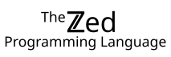

  

Zed is a programming language in which a program is a graph of values and the dependencies between them. The compiler gets parallel scheduling, memory management, safety checks, and incremental recomputation by analyzing that graph.

- Code runs in parallel automatically, and gives bit-identical results on any number of cores.
- Data races, deadlocks, null dereferences, and out-of-bounds errors cannot be written. A failure is an ordinary value, and the type checker makes you handle it.
- Loops and database-style queries compile to the same internal form, so the compiler can run a loop as a hash join, or a join as a loop, whichever costs less.
- If two values could be written to the same key, the program does not compile until you say how to combine them.
- Memory is freed when a value is last used. There is no garbage collector, so there are no collection pauses.
- When an input changes, only the values that depend on it are recomputed.
- The syntax looks like Dart. Type annotations, proofs, and performance hints are optional, and a program without them is still fully statically typed.

### Under construction -- coming soon
